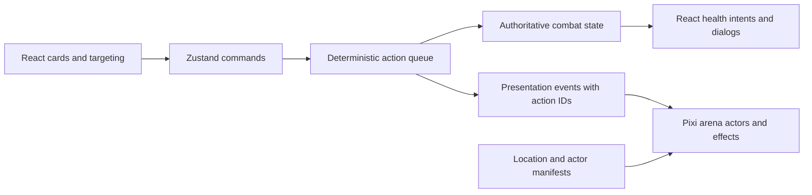

# A 2D battle arena for Selfie the Spire

Research date: November 5, 2026. Status: researched design and implementation proposal, not an implemented or deployed renderer.

## Recommendation

Build a 2D side-view battle scene inside the existing React application. The player and enemies are full-body actors standing on the same street, with shadows, attack poses, hit reactions and defeat animations. Cards remain the player's commands at the bottom of the screen. Health, Block and intent indicators float near actors; no portrait rectangle or card frame encloses a combatant.

Use **PixiJS for the battle scene and React for the interface**, keeping Zustand and the existing action queue authoritative. Start with a single polished encounter using sprite-sheet animation. Expand the same scene renderer to five authored locations through data. Consider skeletal animation after the first scene establishes the art style and mobile performance.

This recommendation is an engineering judgment based on the repository and the official documentation below, not a measured performance comparison. DOM/CSS sprites can also deliver this design and remain a useful prototype or fallback; installing a graphics library alone will not improve the art.

The reference is the original Slay the Spire's separation of cards, creatures and an encounter environment. Its official store provides the gameplay description, trailer and screenshots. Borrow that clarity while creating original Neo Miami characters, staging and effects. This research does not establish which renderer or animation technology Mega Crit used internally. [Official game reference](https://store.steampowered.com/app/646570/Slay_the_Spire/)

## What the repository actually has

| Finding | Consequence |
|---|---|
| React 18, Vite, Zustand and a sequential action queue already exist. | Preserve combat logic and build a presentation adapter. |
| `EntityPanel.tsx` wraps enemies in a portrait-based threat panel. | Replace the visual actor component rather than just removing its border. |
| `Player.spriteUrl` exists, but generated runs assign `generatedCharacter.portraitUrl` to it. | A field named sprite is not a separate combat asset contract. |
| `generateCharacterArt()` requests a full-body hero **with an alley background**, then exports a 512×512 image. | Generation must separate portrait art from transparent battle art. |
| Metadata audit: 23 enemy WebPs, only 3 with alpha channels; five player WebPs, none with alpha. | Most images cannot be composited directly. Alpha presence alone also does not prove a usable cutout. |
| One environment WebP, 1672×941; `CityBackdrop` and the combat label hardcode Ocean Drive. | Add location definitions, camera framing and asset bundles. |
| Current location/encounter data do not define a visual arena. | Add a versioned location ID and deterministic mapping. |
| Target bounds come from DOM rectangles; player bounds are not registered by the same path as enemies. | A canvas arena needs a shared coordinate system for actors, UI and targeting. |
| Existing layout guidance mandates vertically stacked panels. | Revise that guidance during implementation: the user's new actor-based scene takes precedence. |

Inspected files: `src/components/combat/CombatView.tsx`, `EntityPanel.tsx`, `src/components/ui/CityBackdrop.tsx/.css`, `src/core/models.ts`, `src/core/mapModels.ts`, `src/store/gameStore.ts`, `server/src/services/gemini.ts`, and `public/assets/`.

The uncommitted victory-spacing and tactical-combat changes from the preceding pass should remain separate from renderer work. Compare gameplay with and without the new renderer using the same rules revision.

## Rendering options

| Approach | Advantages for this project | Costs / limits | Decision |
|---|---|---|---|
| React + transparent images + CSS/Web Animations | Small migration; native accessible controls; adequate for a hero and three monsters. | Atlas animation, particles, layer sorting and effect orchestration require custom work; DOM animation is not inherently too slow. | Good prototype/fallback and a viable shipping option if motion stays simple. |
| PixiJS canvas stage + React HUD | Sprite rendering, texture atlases, scene graph and centralized effects; leaves existing game systems intact. | Must handle canvas lifecycle, accessible targeting, resolution and resource cleanup. | Recommended for the intended animated presentation. |
| Phaser + React HUD | Established browser-game framework; an official React/Vite integration exists. | More framework surface than the current turn-based stage needs; risks duplicating existing state/timing systems. | Prefer if the scope later includes exploration, physics or several game modes. |
| Full engine migration | Potentially useful for a much larger native game. | Rebuilds working UI and gameplay with substantial migration and deployment work. | Not justified by this visual redesign. |

PixiJS documents sprite transforms and anchors, atlas-oriented optimization, and asset loading/unloading. Phaser's official template demonstrates React/Vite integration. These are capabilities, not evidence that either framework will automatically meet a phone frame-rate target. [PixiJS sprites](https://pixijs.com/8.x/guides/components/scene-objects/sprite), [performance guidance](https://pixijs.com/8.x/guides/concepts/performance-tips), [asset lifecycle](https://pixijs.com/8.x/guides/components/assets), [Phaser integration](https://phaser.io/news/2024/02/official-phaser-3-and-react-template)

**Compatibility:** PixiJS React v8 was designed for React 19; this repository uses React 18. Initially create and destroy a plain PixiJS Application inside a React-owned mount element. Subscribe to deliberate state changes rather than reconciling all animation frames through React. This avoids making a React major-version upgrade a prerequisite. Pin and validate package versions during the spike. [Official React integration announcement](https://pixijs.com/blog/pixi-react-v8-live)

## The battle composition

### Desktop and landscape

- Hero occupies roughly the left quarter, facing right. Monsters occupy the right half, facing left.
- Actors share a visible ground plane. Their feet and contact shadows establish scale and depth.
- Intent icons sit above monsters; health and Block sit near their feet, outside the silhouette.
- Reserve the bottom region for the hand and controls. Decorative foreground elements cannot cover targets or cards.
- A boss gets a separate slot arrangement, not a blindly enlarged normal-enemy rectangle.

### Portrait phones

Do not shrink the entire desktop scene to phone width. Use a distinct camera/layout preset: hero lower-left, monsters staggered upper-right across shallow depth lanes. Preserve the impression that they occupy one street.

At 320px, three enemies plus the hero require deliberately compact silhouettes and independent HUD placement. Use minimum 44px target regions, a dedicated band for intent indicators, and tap-card → choose-target as the reliable interaction. Dragging remains optional. Avoid overlapping target regions; slot separation matters more than decorative scale. If labels collide, move details into the inspection sheet rather than shrinking them indefinitely.

Use normalized anchor slots for each viewport and enemy count, with actor-specific scale and foot anchors. Keep a separate UI coordinate layer. A single `cover` background crop cannot safely position actors or HUD.

```text
Desktop                         Portrait
┌────────────────────────┐      ┌──────────────┐
│ HP / location / deck   │      │ HP / deck    │
│      skyline           │      │  intent row  │
│          intents       │      │   M1 M2 M3   │
│  HERO      M1 M2 M3     │      │ HERO         │
│ ─── shared street ───  │      │ street/shadow│
│ energy        end turn │      │energy  end   │
│       action cards     │      │ action cards │
└────────────────────────┘      └──────────────┘
```

These are composition specifications, not finished concept art or validated phone layouts.

## Five locations from one scene system

Assumption: retain the existing nine-floor run and distribute five districts across it. Five locations do not require five acts or a longer run. If progression changes later, location assignment should be data rather than renderer code.

| Location | Visual identity and ground | Restrained ambient motion | Proposed floors / encounter flavor |
|---|---|---|---|
| Ocean Drive | Peach sunset, teal Art Deco hotels, palms, wet asphalt | Palm sway, reflected signage | 1–2; rats, voltage creatures, alley threats |
| Wynwood After Dark | Violet murals, chain-link, shutters, cracked pavement | Paint-like wisps, distant light sweep | 3–4; graffiti imps and street bruisers |
| Floodline Underpass | Concrete pillars, cyan floodwater, amber utility lights | Water ripple, occasional drips | 5–6; crawlers, specters, sewer creatures |
| Club Backlot | Magenta loading dock, speakers, cables, smoke | Slow haze and restrained light pulses | 7–8; bouncers, boombox creatures, elite fights |
| Skyline Rooftop | Midnight skyline, antennae, storm clouds, roof markings | Wind, distant clouds, subtle sign flicker | 9; boss stage |

These are original art-direction proposals, not researched real-world venue claims. Encounter associations are thematic suggestions; do not silently change existing difficulty tables in the renderer migration.

Each location needs a manifest describing:

- Far background and optional midground; ground/contact plane; optional foreground; bounded effect preset.
- Desktop and portrait framing, ground height, hero anchor, enemy slots and boss slots.
- Light direction, ambient tint and shadow treatment.
- Asset IDs for mobile and desktop variants; transition and fallback assets.
- Optional ambient audio ID, loaded only after normal user audio activation.

Store a stable `locationId` for a run/node or derive it from a versioned floor mapping. Migrate old saves deterministically. Visual variation must not consume the combat RNG. Preload the next required district and release unused textures; do not preload all five full-resolution scenes. Pixi's asset API supports explicit unloading. [Asset lifecycle](https://pixijs.com/8.x/guides/components/assets)

## Art and animation production

The main cost is producing consistent actors, not moving pixels on screen.

**Recommended art direction:** illustrated 2D cutouts with strong silhouettes, simplified shadows, warm/cool neon rim lighting and modest texture. Use a consistent three-quarter side view. Avoid mixing photographic selfie heads, pixel enemies and painted scenery without a deliberate style treatment.

### Static cutouts, sprite sheets or skeletal rigs?

1. **Static cutout with transform animation:** fastest proof of composition, grounded shadows and attack timing. Breathing, lunges and recoil work, but a sliding illustration will not by itself deliver the professional finish requested.
2. **Authored sprite sheets:** recommended first finished encounter. Explicit poses give strong silhouettes and dependable effects. Maintain a common canvas and foot anchor across frames. Export named animation tags and frame timing; Aseprite supports tagged sprite-sheet export. A painted workflow can use another animation/atlas tool. [Aseprite export documentation](https://www.aseprite.org/docs/sprite-sheet/)
3. **Skeletal animation:** useful for reusable hero bodies, equipment and smooth transitions. Requires separated body parts, rigging and art cleanup; a flat generated image cannot simply become a reliable rig. Spine's Pixi runtime supports mixing, animation events and skins, but has a separate runtime license and matching editor/runtime version requirements. Evaluate it after the art direction is proven. [Spine runtime documentation](https://en.esotericsoftware.com/spine-pixi), [runtime licensing information](https://en.esotericsoftware.com/spine-runtimes)

For the first slice, produce one hero and three distinct monsters with **idle, attack/cast, hit, guard, defeat and victory/taunt** states as applicable. That is up to 24 animation states, not 24 individual frames. Define frame counts after a motion test. Start with compact 512px working canvases for ordinary actors, then choose runtime resolution from their actual on-screen size. Bosses may need different proportions.

Asset acceptance checks: actual transparent background, complete feet/limbs, no baked rectangular glow, consistent lighting and facing direction, stable foot anchor, no clipped weapons, clean alpha edges against both pale and dark scenes, and readable silhouette at the smallest phone scale. Atlas packing must preserve trim/pivot metadata to avoid animation jitter.

### Selfie heroes need a separate solution

Split the API contract into `portraitUrl` and a versioned `combatAppearance` that references a real cutout/atlas/rig. Do not keep copying the portrait URL into `spriteUrl`.

Recommended first release: five authored archetype bodies with approved animations; apply a stylized selfie-derived head/portrait and limited palette/accessory customization only where the asset pipeline can maintain alignment. Show the user a preview. A generic archetype actor remains a fallback if battle-art generation fails; preserve their portrait in character UI. This is a quality/reliability tradeoff and will not reproduce every uploaded outfit.

Higher-fidelity alternative: generate a complete character sheet, then perform segmentation, pose consistency review, cleanup and animation production. This is slower and less predictable. Generating every frame independently risks identity and costume drift; it is not validated by this research. Keep generated images as inputs to an art pipeline, not trusted ready-to-animate assets.

Never create a fresh hero image during each battle. Cache/version approved battle assets, handle missing resources, and retain the current photo disclosure and cancellation behavior.

## Engine integration and motion timing



Create a small presentation interface, such as `playCue({actionId, actorId, targetIds, clip, impactAtMs})`, and publish projected actor anchors for DOM HUD and target controls. The effect queue remains the only writer of HP, Block, energy and statuses. Animation callbacks must never independently apply damage.

For attacks, coordinate anticipation → travel/swing → impact → reaction → recovery. An initial tuning range could be 100–160ms anticipation, 100–180ms attack, and 150–250ms reaction/recovery, with overlap where appropriate. These are proposed timings, not measured standards. Multi-hit attacks need distinct impact cues; area attacks resolve one cue across targets, and Block hits should look different from HP damage.

Use a presentation barrier or shared impact marker with a bounded timeout and cancellation token. Damage applies exactly once at the authoritative impact step; a missing texture, reduced-motion setting, tab suspension or context loss must not stall the battle. Skip or complete purely visual cues safely when the tab resumes. Preserve dead-target guards and invalidate old animation callbacks when starting a new battle.

The existing `resolveEffects()` and animation queue are the integration points. Add presentation metadata separately from mechanics, so generated cards continue to use generic `Effect[]`. Select attack/cast/guard effects from card/effect metadata rather than writing a new engine branch per card.

## Performance and accessibility targets

Proposed budgets to validate on hardware, not current measurements:

- Aim for stable 60fps during ordinary combat on the selected midrange phone; provide a 30fps/low-effects mode if necessary.
- Start with a renderer resolution cap of 1.5–2 device pixels per CSS pixel, tuned by profiling rather than blindly matching high phone DPR.
- Aim for an initial battle-art payload around 3–5 MB compressed and a measured texture working set below roughly 64–96 MiB; adjust only with evidence.
- A 2048×2048 RGBA texture alone is 16 MiB before mipmaps/extra copies. Five compressed WebP backgrounds do not imply five small GPU allocations. Track decoded dimensions as well as network size.
- Avoid full-screen blur/bloom passes as the default. Prefer painted light and small effect sprites; cap particles and stop hidden-tab ambient work.
- Ensure resources return near baseline after repeated battle/location changes. Exercise graphics context loss and retry/fallback behavior.

Pixi recommends atlases and smaller assets for older devices and warns about expensive masks. MDN distinguishes download compression from GPU texture memory and discusses resolution/memory tradeoffs. [Pixi performance](https://pixijs.com/8.x/guides/concepts/performance-tips), [WebGL best practices](https://developer.mozilla.org/en-US/docs/Web/API/WebGL_API/WebGL_best_practices)

Maintain semantic DOM controls for monsters, intent inspection and the hand, with keyboard navigation and visible focus. Canvas is decorative from the screen reader's perspective when an equivalent DOM control conveys the actor and action. Keep announcements concise. Reduced motion disables camera shake, strong parallax and repeated ambient pulses while retaining readable state transitions. [Reduced-motion preference](https://developer.mozilla.org/en-US/docs/Web/CSS/Reference/At-rules/@media/prefers-reduced-motion)

## Implementation sequence and acceptance gates

| Stage | Deliverable | Exit condition |
|---|---|---|
| 1. Composition and asset spike | One street, one hero, one monster, portrait/landscape slot presets; transparent test assets | Clearly reads as characters on one ground plane at 320px and desktop; no actor card frames. |
| 2. Finished encounter | Hero plus three monsters, animation states, HUD anchors, impact timing, targeting | Complete a real fight and reward flow; all attack/defense/status outcomes match existing rules. |
| 3. Five locations | Versioned manifests, all backgrounds, transition preload, mobile crops | Every location works with one/three enemies and a boss; no label/feet/hand collisions. |
| 4. Selfie integration | Separate combat asset contract, archetype fallback, preview and failure handling | Generated run works even if battle art fails or expires; no rectangular portrait substituted as an actor. |
| 5. Release hardening | Device evidence, memory/animation tests, demo route and documentation | Full run, reload and background/resume checks pass; production has no review fixtures. |

Suggested file boundaries: `src/components/combat/BattleStage.tsx`, `src/rendering/BattleScene.ts`, `src/rendering/CombatPresentation.ts`, `src/data/locations.ts`, `src/data/actorVisuals.ts`, and `public/assets/battle/{actors,locations,fx}`. Keep these names provisional until implementation.

Do not expand all 23 monsters into bespoke animation sets before validating one polished encounter. A starter hero plus three finished monsters is a convincing portfolio milestone; global coverage is a separate production task. With suitable art ready, a technical slice may take several focused days; bespoke animation and five-location polish can take multiple weeks. This is a rough planning estimate, not a delivery commitment.

## Verification matrix

1. **Visual:** 320×568, 390×844, 430×932, 844×390, tablet and 1440×900. Capture all five locations with 1, 2 and 3 monsters plus a boss. Check alpha edges, grounded feet, consistent scale, intent collision, hand overlap and target alignment.
2. **Rules parity:** same seed and input sequence with animations on, off and reduced; identical HP, energy, draw order, statuses and reward results. Include multi-hit, all-enemy, Burn kill before attack, Thorns retaliation, blocked hit and simultaneous defeat cases.
3. **Input:** tap inspection, tap targeting, optional drag, keyboard-only, target disappears during animation, repeated taps, browser zoom and orientation change while targeting.
4. **Lifecycle:** load/save during supported states, reload, tab background/foreground, resize, unmount/remount, missing atlas, slow network, graphics context loss, no late callbacks changing a new run.
5. **Performance:** real iOS Safari and Android Chrome, including one lower-powered device; ten-minute battles and repeated district transitions. Capture frame-time and memory/resource trends rather than relying on screenshots or Lighthouse alone.
6. **Generation:** existing saves lacking combat assets, failed generation, incorrect alpha, missing remote image and portrait-only fallback. Validate image dimensions and asset schema before display.
7. **Portfolio review:** a new visitor should identify the hero, read the imminent enemy action and play a card without explanation. Record the complete experience on a phone, including rewards and returning to the map.

## Open uncertainties

The renderer choice is supported by capability research but has not been benchmarked in this repository. The proposed art style and portrait composition need an actual visual prototype. Generated full-body identity consistency is unproven. Five-location progression is a proposed mapping, not an approved expansion of run length. Asset authoring effort and any paid animation-tool licensing should be scoped before commissioning a full roster.

No gameplay code or production deployment was changed for this research pass. The next concrete step is the Stage 1 composition/asset spike, followed by a finished encounter rather than a broad engine rewrite.
